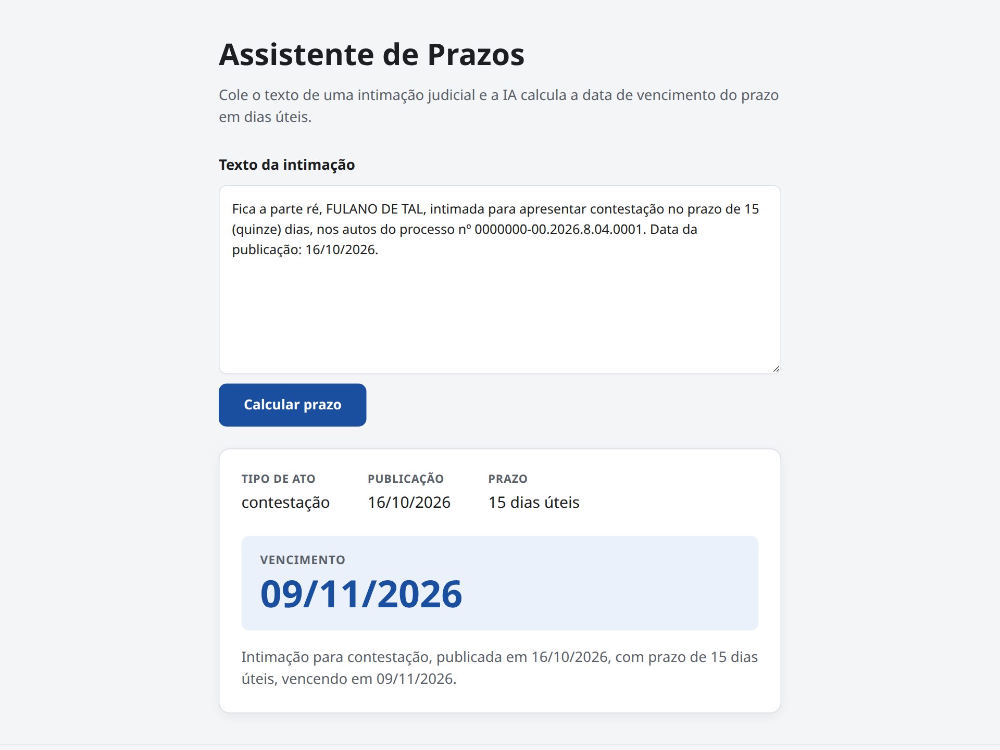

# Assistente de Prazos

Agente de IA que lê o texto de uma intimação judicial e calcula a data de
vencimento do prazo em dias úteis. **Projeto didático — não use para prazos
reais.**



## Arquitetura

- O **LLM interpreta o texto; o Java decide a data** — o modelo nunca calcula datas.
- `AssistentePrazos` é uma interface LangChain4j (`@AiService` + `@SystemMessage`)
  que extrai tipo de ato, data de publicação e prazo em dias da intimação.
- Ela chama a ferramenta `CalculadoraPrazos.calcularVencimento` (`@Tool`),
  cuja contagem de dias úteis é 100% determinística.
- `PrazoController` expõe `POST /api/prazos` e devolve o record `RespostaPrazo`.
- Front-end Vue 3 (Vite) chama a API; em produção é servido pelo próprio jar.

## Requisitos

- Java 21 e Maven 3.9+ para o back-end.
- Node 20+ para desenvolver o front-end (o `mvn package` instala um Node próprio
  via `frontend-maven-plugin`, sem depender do Node local).
- Variável de ambiente `OPENAI_API_KEY` com uma chave da OpenAI.
- O modelo é configurável em `application.yml` (`langchain4j.open-ai.chat-model.model-name`)
  ou via variável `OPENAI_MODEL` (padrão: `gpt-4o-mini`).

## Como rodar

### Desenvolvimento (2 terminais)

```bash
# terminal 1 — back-end em http://localhost:8080
export OPENAI_API_KEY=sk-...
mvn spring-boot:run

# terminal 2 — front-end em http://localhost:5173 (proxy /api -> :8080)
cd frontend
npm install
npm run dev
```

### Produção (jar único)

```bash
export OPENAI_API_KEY=sk-...
mvn package
java -jar target/assistente-prazos-0.0.1-SNAPSHOT.jar
# abra http://localhost:8080
```

## Exemplo de uso

```bash
curl -X POST http://localhost:8080/api/prazos \
  -H 'Content-Type: application/json' \
  -d '{
    "intimacao": "Fica a parte ré, FULANO DE TAL, intimada para apresentar contestação no prazo de 15 (quinze) dias, nos autos do processo nº 0000000-00.2026.8.04.0001. Data da publicação: 16/10/2026."
  }'
```

Resposta:

```json
{
  "tipoAto": "contestação",
  "dataPublicacao": "2026-10-16",
  "diasUteis": 15,
  "vencimento": "2026-11-09",
  "resumo": "Intimação para contestação, publicada em 16/10/2026, com prazo de 15 dias úteis, vencendo em 09/11/2026."
}
```

## Regras do cálculo

- A contagem começa no **primeiro dia útil seguinte** à data de publicação; o dia
  da publicação não conta.
- Só contam dias úteis: sábados, domingos e feriados nacionais são pulados.
- O vencimento é sempre um dia útil.
- Feriados nacionais de 2026 ficam configuráveis em `application.yml`
  (`prazos.feriados`).

### Fora do escopo (propositalmente)

- Recesso forense (20/12 a 06/01, quando prazos processuais ficam suspensos).
- Feriados estaduais/municipais e suspensões de prazo por decisão judicial.
- Intimações sem data de publicação ou sem prazo explícito.

## Testes

```bash
mvn test
```

`CalculadoraPrazosTest` cobre publicação em sexta-feira, feriado no meio do
prazo, virada de mês, véspera de feriado e prazo de 1 dia.
`PrazoControllerTest` usa o `AssistentePrazos` mockado — nenhum teste chama a
API real da OpenAI.
